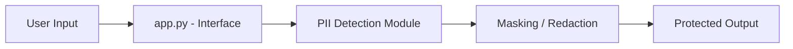

# Technical Design Document

## Overview
I2PE PII Protection Engine detects Personally Identifiable Information (PII) in user input and masks it before the data is stored or shared.

## Architecture Diagram



## Components
| Component | Description |
|-----------|-------------|
| Interface (app.py) | Takes input from the user and shows the result |
| PII Detection | Finds names, phone numbers, emails, Aadhaar etc. (regex / NLP) |
| Masking | Replaces detected PII with placeholders like `[MASKED]` |
| Output | Returns the sanitized text |

## Data Flow
1. User submits text or a file.
2. The detection module scans for PII patterns.
3. Each match is masked.
4. The sanitized result is returned to the user.

## Tech Stack
- Python
- Libraries listed in `requirements.txt`

## Security Considerations
- No raw PII is stored or logged.
- Secrets are kept in environment variables, not in the code.
```
